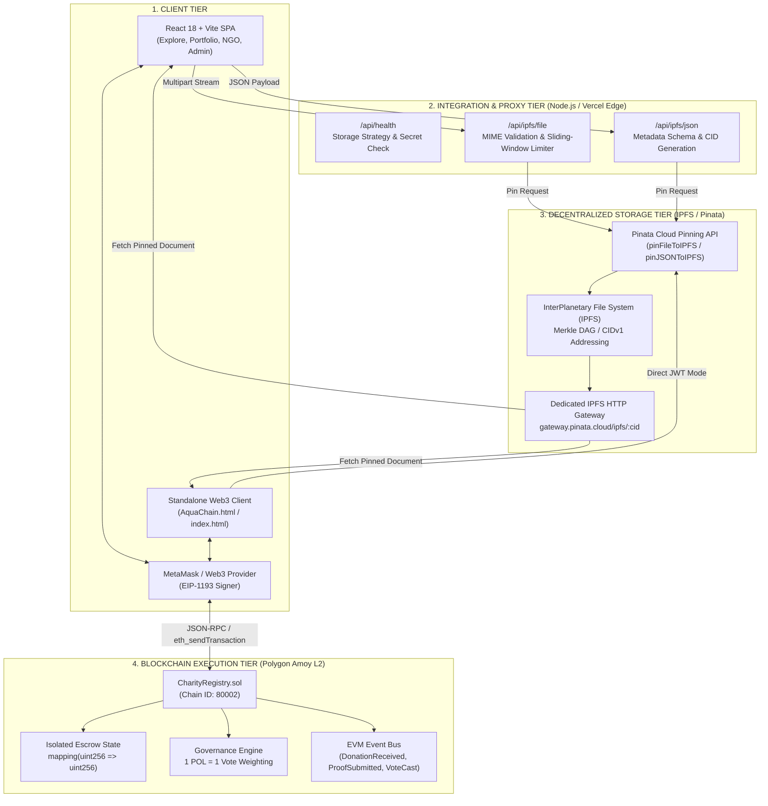
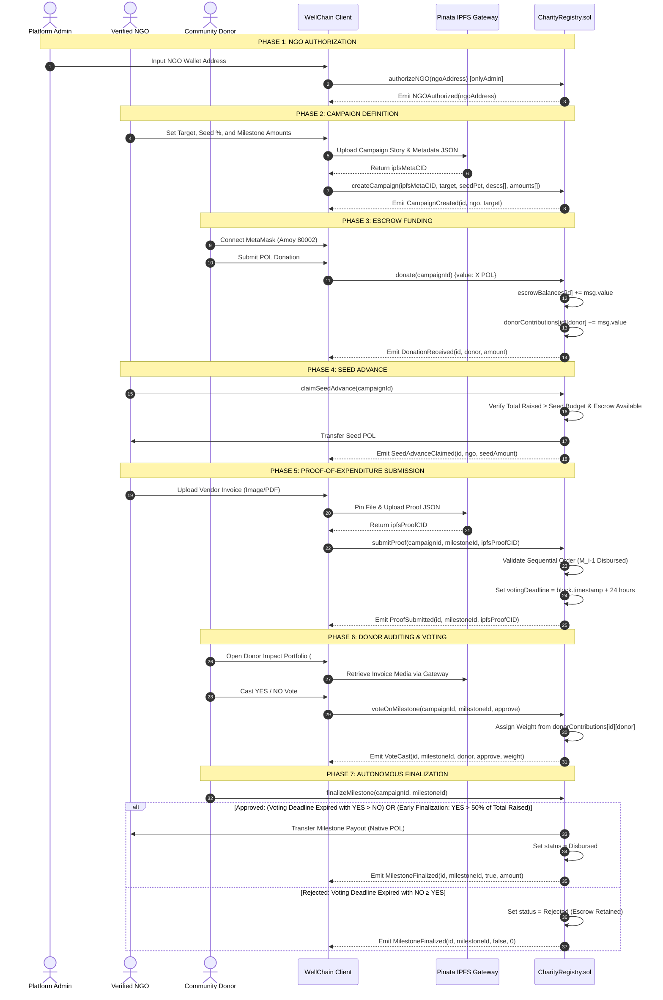

# WellChain: Transparent Charity Donation and Milestone-Escrow Protocol

> **Submission for Problem Statement 3.3 — Transparent Charity Donations on the Blockchain**  
> *A decentralized, audit-enforced philanthropy protocol combining isolated smart contract escrow, IPFS content-addressed proof-of-expenditure storage, and donor-governed milestone releases.*

---

## Quick Access Hub

| Resource | Verified Location / URL | Description |
| :--- | :--- | :--- |
| **Source Code Repository** | [`github.com/Shubhdix9/segfault`](https://github.com/Shubhdix9/segfault) | Monorepo containing Contracts, Frontend, Backend, and Test suites |
| **Live Web Application** | [`segfault-blond.vercel.app`](https://segfault-blond.vercel.app/) | Production frontend deployed on Vercel Edge Network |
| **Admin & Management Portal** | [`segfault-blond.vercel.app/#admin`](https://segfault-blond.vercel.app/#admin) | Client-side hash route for NGO Authorization & Whitelisting Console |
| **Standalone Web3 Portal** | [`segfault-blond.vercel.app/AquaChain.html`](https://segfault-blond.vercel.app/AquaChain.html) | Zero-build, single-file HTML/JS Web3 client with direct RPC connectivity |
| **Blockchain Network** | **Polygon Amoy Testnet** | Chain ID: `80002` (`0x13882`) \| Native Gas Token: `POL` |
| **Deployed Contract Address (Amoy)** | [`0x9A54C287d3a06148A6F0025D89a8cbb42125f46B`](https://amoy.polygonscan.com/address/0x9A54C287d3a06148A6F0025D89a8cbb42125f46B) | Deployed `CharityRegistry` bytecode address on Polygon Amoy |
| **Admin / Deployer Address** | `0x73d26C21d0b94E5a6c10aB3d77e2F09c91bc0001` | Deployer account holding platform administrator role |
| **Block Explorer** | [`amoy.polygonscan.com`](https://amoy.polygonscan.com/) | Public block explorer for tracking transactions, event logs, and contract state |
| **Smart Contract Source** | [`charityregistry/contracts/CharityRegistry.sol`](./charityregistry/contracts/CharityRegistry.sol) | Core escrow, governance, and audit smart contract |

*(Note: Public addresses above represent public testnet identities and deployed bytecode locations; no private keys or secrets are stored or exposed.)*

---

## Table of Contents

1. [Problem Statement Traceability Matrix](#1-problem-statement-traceability-matrix)
2. [Complete Financial Accountability Model](#2-complete-financial-accountability-model)
3. [Smart Contract Architecture & Invariant Enforcement](#3-smart-contract-architecture--invariant-enforcement)
4. [Critical Governance Limitation: Mid-Vote Contribution Dynamics](#4-critical-governance-limitation-mid-vote-contribution-dynamics)
5. [On-Chain Event-Based Audit Trail](#5-on-chain-event-based-audit-trail)
6. [Governance and Voting Economics](#6-governance-and-voting-economics)
7. [Client-Side Security and Credential Architecture](#7-client-side-security-and-credential-architecture)
8. [IPFS Technical Architecture & Proof-of-Expenditure Integrity](#8-ipfs-technical-architecture--proof-of-expenditure-integrity)
9. [NGO Verification and Accountability Framework](#9-ngo-verification-and-accountability-framework)
10. [India Deployment & Statutory Considerations (Post-April 2026)](#10-india-deployment--statutory-considerations-post-april-2026)
11. [System Architecture](#11-system-architecture)
12. [Complete End-to-End Protocol Workflow](#12-complete-end-to-end-protocol-workflow)
13. [Technology Stack & Technical Rationale](#13-technology-stack--technical-rationale)
14. [Repository Folder Structure](#14-repository-folder-structure)
15. [Installation, Configuration, and Local Execution](#15-installation-configuration-and-local-execution)
16. [Empirical Operational and Performance Evaluation](#16-empirical-operational-and-performance-evaluation)
17. [Testing and Verification Suites](#17-testing-and-verification-suites)
18. [Illustrative Application Wireframes and Interface Walkthrough](#18-illustrative-application-wireframes-and-interface-walkthrough)
19. [Limitations and Planned Improvements](#19-limitations-and-planned-improvements)
20. [Academic and Technical References](#20-academic-and-technical-references)
21. [Team Members and Contributions](#21-team-members-and-contributions)
22. [Licensing and Disclaimers](#22-licensing-and-disclaimers)

---

## 1. Problem Statement Traceability Matrix

The table below maps each requirement of **Hackathon Problem Statement 3.3** to the concrete architecture and implementation in this repository:

| Problem Statement 3.3 Requirement | WellChain Proposed Solution | Concrete Implementation in Repository | Verifiable Code / Test Evidence | Current Architectural Limitation |
| :--- | :--- | :--- | :--- | :--- |
| **Trust Deficit & Transparent Tracking** *(Donors rarely know whether their money reached the intended cause)* | Public on-chain ledger recording individual donor contributions, milestone states, and disbursements | `CharityRegistry.sol::donate()`, `donorContributions` mapping, `DonationReceived` event | `charityregistry/contracts/CharityRegistry.sol#L150-L166`, `charityregistry/test/CharityRegistry.test.js#L93-L105` | On-chain ledger tracks native POL tokens; donations are uncapped and real-world purchasing power fluctuates with market volatility. |
| **Milestone-Based Fund Release** *(Preventing lump-sum diversion before project delivery)* | Phased escrow where payouts are locked until milestone proof is submitted, reviewed, and finalized via deadline or early majority | `CharityRegistry.sol::claimSeedAdvance()`, `submitProof()`, `finalizeMilestone()` | `CharityRegistry.sol#L169-L254`, `CharityRegistry.test.js#L107-L121, L184-L222` | Rejected milestones leave funds permanently locked in escrow; the contract does not currently feature an automated refund clawback. |
| **Proof-of-Work / Proof-of-Expenditure Evidence on IPFS** *(Verifiable bills, vendor invoices, receipts)* | Content-addressed evidence storage via IPFS with hash binding on-chain | `backend/server.js`, `api/ipfs/file.js`, `frontend/src/services/ipfs.js`, `CharityRegistry.sol::submitProof()` | `backend/server.js#L205-L224`, `frontend/src/services/ipfs.test.js#L12-L29` | IPFS guarantees cryptographic data integrity and tamper-evidence, but cannot independently verify whether a vendor invoice was physically authentic off-chain. |
| **Public Donation Tracking Page** *(Public verification for crowdfunding platforms and auditors)* | Skeuomorphic public explorer rendering milestone receipts, raised amounts, and IPFS links | `frontend/src/components/ExplorePage.jsx`, `AquaChain.html#explore` | `frontend/src/components/ExplorePage.jsx#L1-L36`, `AquaChain.html#L920-L938` | Relies on public JSON-RPC gateway uptime to fetch state in real time. Client-side navigation uses URL hash routes (`#explore`, `#admin`). |
| **Bonus: Donor Impact Dashboard** *(Personalized live trail of fund usage and voting)* | Personalized portfolio aggregating backed campaigns, donor vote weighting, and milestone actions | `frontend/src/components/PortfolioPage.jsx`, `CharityRegistry.sol::getDonorCampaigns()` | `frontend/src/components/PortfolioPage.jsx#L1-L68`, `CharityRegistry.sol#L257-L259` | Portfolio filtering requires the donor's Web3 wallet address to match recorded contribution mappings. |

---

## 2. Complete Financial Accountability Model

### Protocol Financial Flow

The lifecycle of capital within WellChain follows a strictly ordered, conditional pipeline:

```
[ Donor Wallet ] ──(1. Native POL)──► [ Campaign Escrow (CharityRegistry.sol) ]
                                             │
      ┌──────────────────────────────────────┴──────────────────────────────────────┐
      ▼                                                                             ▼
[ Initial Seed Advance ]                                              [ Milestone Payouts (1..N) ]
• Capped at ≤ 50% of Campaign Target                                  • Σ(Milestones) ≤ Target - Seed
• Unlocked when Total Raised ≥ Seed Budget                            • Requires sequential proof submission
• Direct transfer to Verified NGO wallet                              • Unlocked either upon 24h deadline expiry (YES > NO)
                                                                        OR earlier when YES > 50% of Total Raised
                                                                      • Direct transfer to Verified NGO wallet
```

### Mathematical Accounting Invariants

For any campaign $c \in \{1, \dots, \text{campaignCounter}\}$:

1. **Target Budget Constraint:**
   The sum of the pre-budgeted seed advance and all milestone allocations cannot exceed the campaign target:
   $$\text{SeedBudget}_c + \sum_{i=0}^{k-1} \text{MilestoneAmount}_{c,i} \le \text{TargetAmount}_c$$
   where the seed advance budget is computed using precision-safe integer arithmetic:
   $$\text{SeedBudget}_c = \left\lfloor \frac{\text{TargetAmount}_c \times \text{SeedAdvancePct}_c}{100} \right\rfloor + \left\lfloor \frac{(\text{TargetAmount}_c \pmod{100}) \times \text{SeedAdvancePct}_c}{100} \right\rfloor$$
   *Enforced in:* `CharityRegistry.sol#L114-L121`

2. **Campaign-Isolated Escrow Accounting:**
   Each campaign maintains an isolated accounting balance in `escrowBalances[c]`. The contract invariant at any block is:
   $$\text{escrowBalances}[c] = \text{totalRaised}_c - \left( \mathbf{1}_{\{\text{seedClaimed}_c\}} \times \text{SeedBudget}_c \right) - \sum_{i \in \mathcal{D}_c} \text{MilestoneAmount}_{c,i}$$
   where $\mathcal{D}_c$ is the set of milestone indices for campaign $c$ that have achieved `MilestoneStatus.Disbursed`.
   *Enforced in:* `CharityRegistry.sol#L156, L178, L244`

3. **Global Contract Solvency Inequality:**
   The total native POL balance held by the smart contract bytecode is greater than or equal to the aggregate sum of all isolated campaign escrows:
   $$\text{address}(\text{this}).\text{balance} \ge \sum_{c=1}^{\text{campaignCounter}} \text{escrowBalances}[c]$$
   *Mathematical Rationale:* Under standard protocol execution, every incoming donation increments `escrowBalances[c]` by `msg.value`, and every disbursement decrements it by the payout amount, preserving strict equality. The inequality ($\ge$) accounts for external native tokens that may enter the contract without executing protocol functions (such as `selfdestruct` transfers from external contracts or validator block rewards). Conversely, a strict deficit ($\text{address}(\text{this}).\text{balance} < \sum \text{escrowBalances}[c]$) would represent an existential insolvency condition that would cause valid disbursements to revert. In addition, campaign balances are strictly partitioned: funds contributed to Campaign $A$ cannot cross-subsidize Campaign $B$; if Campaign $B$ has insufficient escrow, its milestone payout transaction will revert with `"Insufficient campaign escrow"`.

4. **Uncapped Donations and Lack of Campaign-Closing Mechanism:**
   In `CharityRegistry.sol::donate()`, contributions are **uncapped**: there is no upper-bound check (`totalRaised + msg.value <= targetAmount`). Campaigns can continue receiving funds past their initial target. Furthermore, while `c.isActive` is initialized to `true` upon campaign creation, `CharityRegistry.sol` contains **no administrative, temporal, or milestone-completion function to set `isActive = false`** or close a campaign. Active campaigns remain open to incoming donations indefinitely, even after all milestone disbursements have been completed.

5. **Rejected Milestone Accounting:**
   When a milestone fails donor review, its status becomes `MilestoneStatus.Rejected` and `MilestoneFinalized(c, i, false, 0)` is emitted. The allocated funds remain inside `escrowBalances[c]`. The smart contract does not automatically redistribute or refund these tokens to donors.

---

## 3. Smart Contract Architecture & Invariant Enforcement

The core business logic is implemented in **[`charityregistry/contracts/CharityRegistry.sol`](./charityregistry/contracts/CharityRegistry.sol)**.

### Data Structures & State Mappings

```solidity
enum MilestoneStatus { Pending, ProofSubmitted, Approved, Rejected, Disbursed }

struct Milestone {
    string description;
    uint256 amount;
    string ipfsProofCID;
    MilestoneStatus status;
    uint256 yesVotes;
    uint256 noVotes;
    uint256 votingDeadline;
}

struct Campaign {
    uint256 id;
    address payable ngoAddress;
    string ipfsMetaCID;
    uint256 targetAmount;
    uint256 totalRaised;
    uint256 seedAdvancePct;
    bool seedClaimed;
    uint256 milestoneCount;
    bool isActive;
}
```

### Enforced Smart Contract Invariants

1. **Restricted Campaign Creation:** Only addresses with `isVerifiedNGO[msg.sender] == true` can invoke `createCampaign`. (`CharityRegistry.sol#L110`)
2. **Cap on Seed Advances:** `_seedAdvancePct` cannot exceed 50% (`require(_seedAdvancePct <= 50)`). (`CharityRegistry.sol#L114`)
3. **Budget Commitment Enforcement:** `milestoneBudget <= _targetAmount - seedBudget`. Over-budget milestone definitions revert during creation. (`CharityRegistry.sol#L121`)
4. **Seed Claim Activation:** An authorized NGO can call `claimSeedAdvance` only after `totalRaised >= seedAmount` and `escrowBalances[c] >= seedAmount`. It cannot be claimed more than once. (`CharityRegistry.sol#L172-L175`)
5. **Sequential Milestone Order:** An NGO cannot submit proof for milestone $i$ ($i > 0$) unless milestone $i-1$ is already in `MilestoneStatus.Disbursed`. (`CharityRegistry.sol#L191-L196`)
6. **Single Vote per Address:** Donors can vote on milestone $(c, i)$ exactly once (`require(!hasVoted[c][i][msg.sender])`). (`CharityRegistry.sol#L223`)
7. **Dual-Trigger Disbursement Condition:** A milestone payout can be finalized and disbursed if: (a) the 24-hour voting deadline has passed and affirmative votes exceed negative votes (`block.timestamp > m.votingDeadline && m.yesVotes > m.noVotes`), OR (b) affirmative votes achieve an early majority surpassing half of the campaign's total raised capital (`m.yesVotes > c.totalRaised / 2`), provided `escrowBalances[c] >= m.amount`. (`CharityRegistry.sol#L236-L244`)
8. **Checks-Effects-Interactions Ordering:** State and escrow balance updates occur prior to low-level external transfers (`.call{value: ...}("")`). (`CharityRegistry.sol#L178-L180, L244-L246`)

---

## 4. Critical Governance Limitation: Mid-Vote Contribution Dynamics

A rigorous security audit of `CharityRegistry.sol` reveals a critical governance edge case in the interaction between `donate()` and `voteOnMilestone()`:

### The Vulnerability: Dynamic Voting Weight Mutation

1. **Dynamic Weight Lookup:**
   In `CharityRegistry.sol#L210`, voting weight is read dynamically from `donorContributions` at the exact block when the vote is cast:
   ```solidity
   uint256 votingWeight = donorContributions[_campaignId][msg.sender];
   ```
2. **Uncapped and Continuous Donations:**
   `donate()` does not halt donations after milestone proof submission, nor does it enforce an upper ceiling at `targetAmount`. It allows donations as long as `c.isActive == true`.
3. **Exploit Scenario:**
   - Milestone proof is submitted on Day 0, opening a 24-hour voting window.
   - A donor or colluding entity holding 1 POL notices that negative votes are winning at Hour 23.
   - The entity executes `donate(campaignId)` with 100 POL, instantly inflating `donorContributions[campaignId][msg.sender]` to 101 POL.
   - The entity then calls `voteOnMilestone(campaignId, milestoneId, true)`, casting 101 votes and unilaterally overturning the community's decision.
4. **Dynamic Early Finalization Threshold:**
   Early finalization checks:
   ```solidity
   m.yesVotes > (campaigns[_campaignId].totalRaised / 2)
   ```
   Because `totalRaised` increases whenever new donations arrive, the mathematical bar for early finalization shifts upward in real time while voting is active.

### Proposed Improvement (Historical Snapshotting)

To eliminate mid-vote governance manipulation in production releases:
- Implement a **checkpointed balance mapping** (similar to OpenZeppelin's `ERC20Votes` or `Checkpoints.sol`).
- When `submitProof()` is executed, capture a block snapshot.
- Restrict voting weight strictly to the donor's cumulative contribution recorded **at or before** the snapshot block.

---

## 5. On-Chain Event-Based Audit Trail

`CharityRegistry.sol` emits 9 standardized EVM events documenting every financial and governance transition:

```solidity
event AdminTransferred(address indexed oldAdmin, address indexed newAdmin);
event NGOAuthorized(address indexed ngoAddress);
event NGORevoked(address indexed ngoAddress);
event CampaignCreated(uint256 indexed campaignId, address indexed ngo, uint256 targetAmount);
event DonationReceived(uint256 indexed campaignId, address indexed donor, uint256 amount);
event SeedAdvanceClaimed(uint256 indexed campaignId, address indexed ngo, uint256 amount);
event ProofSubmitted(uint256 indexed campaignId, uint256 indexed milestoneId, string ipfsCID);
event VoteCast(uint256 indexed campaignId, uint256 indexed milestoneId, address indexed voter, bool approve, uint256 weight);
event MilestoneFinalized(uint256 indexed campaignId, uint256 indexed milestoneId, bool approved, uint256 amountDisbursed);
```

### Public Verification Procedure Using Polygon Amoy Explorer

External auditors can verify campaign accounting on Polygon Amoy Explorer without relying on any frontend interface:

1. **Locate Registry Contract:** Navigate to `https://amoy.polygonscan.com/address/0x9A54C287d3a06148A6F0025D89a8cbb42125f46B#events`.
2. **Trace Campaign Creation:** Filter event logs for `CampaignCreated`. Note the `campaignId`, `ngo` address, and `targetAmount`.
3. **Reconcile Total Donations:** Filter `DonationReceived` logs by `campaignId`. Sum the `amount` values to independently verify the contract's `totalRaised`.
4. **Inspect Proof-of-Expenditure on IPFS:** Locate `ProofSubmitted` for milestone $i$. Extract the `ipfsCID` and retrieve the pinned receipt from any public IPFS gateway:
   ```bash
   curl -sL https://gateway.pinata.cloud/ipfs/<ipfsCID>
   ```
5. **Tally Community Votes:** Filter `VoteCast` logs by `campaignId` and `milestoneId`. Sum `weight` where `approve == true` versus `approve == false`.
6. **Verify Final Disbursement:** Check `MilestoneFinalized`. If `approved == true`, verify that the internal transaction transferred native POL to the authorized NGO wallet.

### Blockchain State vs. Frontend Display Data

| Data Element | Source of Truth | Verification Method | Failure Mode |
| :--- | :--- | :--- | :--- |
| **Escrow Balances & Disbursed POL** | Polygon Amoy EVM Storage (`escrowBalances`) | Blockchain consensus | Requires 51% validator compromise |
| **Individual Voting Weights** | Contract Storage (`donorContributions`) | EVM state transition | Deterministically enforced by bytecode |
| **Campaign Narrative & Banner Images** | IPFS Metadata Document (`ipfsMetaCID`) | Content Addressing (SHA-256 Merkle root) | Gateway outage (data persists on pinning nodes) |
| **Vendor Invoices & Store Receipts** | IPFS Binary Payload (`ipfsProofCID`) | Content Addressing (SHA-256 Merkle root) | Image cryptographic integrity guaranteed; off-chain physical truth unverified |
| **Presentation Mode Personas** | Browser Local Storage (`demoStoreKey`) | Local client state | Client-side only; rejected by live smart contracts |

---

## 6. Governance and Voting Economics

### Governance Mechanism (As Implemented)

* **Voter Eligibility:** An address can vote on campaign $c$ if and only if `donorContributions[c][msg.sender] > 0`.
* **Voting Weight:** Linear capital weighting: $\text{Weight} = \text{donorContributions}[c][\text{msg.sender}]$.
* **Voting Window:** Exactly 24 hours (`86,400` seconds) from proof submission (`m.votingDeadline = block.timestamp + 1 days`).
* **Standard Approval Condition:**
  $$\text{Finalize Approved} \iff \text{block.timestamp} > \text{votingDeadline} \land \text{yesVotes} > \text{noVotes}$$
* **Accelerated Early Finalization:**
  A milestone can be finalized before the 24-hour deadline if affirmative votes surpass an absolute majority of total funds raised:
  $$\text{Early Finalize} \iff \text{yesVotes} > \left\lfloor \frac{\text{totalRaised}_c}{2} \right\rfloor$$
* **Rejection Condition:**
  $$\text{Finalize Rejected} \iff \text{block.timestamp} > \text{votingDeadline} \land \text{yesVotes} \le \text{noVotes}$$

> [!IMPORTANT]
> **Absence of Minimum Quorum Enforcement:**
> The current smart contract implementation does **not** enforce a minimum voting-turnout quorum. If only one donor holding 0.01 POL casts a vote within 24 hours, that single vote determines whether the milestone payout is approved or rejected.

### Economic Considerations & Governance Attack Vectors

1. **Contribution Concentration (Whale Dominance):**
   Under linear weighting ($1 \text{ POL} = 1 \text{ Vote}$), an entity contributing 51% of funds holds unilateral governance control, rendering the oversight of smaller contributors ineffective.
2. **Collusion Vulnerability:**
   An NGO could allocate capital to its own campaign to secure voting weight and approve its own milestone payouts.
3. **Proposed Roadmap: Quadratic Voting:**
   Future releases should evaluate Quadratic Voting to dilute capital concentration:
   $$\text{Voting Power} = \sqrt{\text{POL Contributed}}$$
   Under quadratic voting, 100 contributors donating 1 POL each yield $100 \times \sqrt{1} = 100$ votes, whereas a single donor contributing 100 POL yields $\sqrt{100} = 10$ votes. Implementing this securely requires Sybil-resistant identity primitives (such as Gitcoin Passport or WorldID).

---

## 7. Client-Side Security and Credential Architecture

WellChain provides two distinct frontend interfaces with different security profiles:

```
┌────────────────────────────────────────────────────────────────────────────────────────┐
│                        WELLCHAIN FRONTEND SECURITY TAXONOMY                            │
├───────────────────────────────────┬────────────────────────────────────────────────────┤
│ React Application (frontend/)     │ Standalone Single-File Client (AquaChain.html)     │
├───────────────────────────────────┼────────────────────────────────────────────────────┤
│ • Uses Node.js / Vercel Edge Proxy│ • Connects directly to Pinata API or simulated mode│
│ • Zero client-side API secrets    │ • Reads Pinata JWT from browser localStorage       │
│ • PINATA_JWT stored server-side   │ • User-configured JWT is exposed client-side       │
│ • Enforces MIME validation & CORS │ • Intended for zero-build local & testnet audits   │
└───────────────────────────────────┴────────────────────────────────────────────────────┘
```

### Direct POL Transfer Fallback in Standalone Mode

In `AquaChain.html`, if MetaMask is connected but **no contract address is specified** (`!CONFIG.address`), the application falls back to a direct wallet-to-wallet transfer:
```javascript
const tx = await S.signer.sendTransaction({
  to: dest,
  value: ethers.utils.parseEther(String(value))
});
```

> [!WARNING]
> **Security Advisory:**
> This fallback executes a direct transfer of native POL to the NGO's wallet address. **It does not interact with the smart contract.** Capital sent via this fallback is not placed in escrow, is not subject to milestone locking, and receives no governance or refund protection.

---

## 8. IPFS Technical Architecture & Proof-of-Expenditure Integrity

### Content Addressing Specification (CIDv1)

An IPFS Content Identifier is not a simple flat file hash. It is a self-describing cryptographic identifier formatted according to the **Multiformats** specification:

$$\text{CIDv1} = \langle\text{multibase-prefix}\rangle\langle\text{cid-version}\rangle\langle\text{multicodec-content-type}\rangle\langle\text{multihash}\rangle$$

1. **Merkle DAG Construction (UnixFS):**
   Files uploaded through the WellChain proxy exceeding the block threshold (typically 256 KiB) are split into UnixFS chunks. A Merkle Directed Acyclic Graph (DAG) is constructed, where intermediate nodes store references to child chunks. The root hash of this Merkle DAG forms the resulting CID.
2. **Cryptographic Data Integrity & Tamper-Evidence:**
   IPFS does not provide global, ledger-wide immutability in the manner of a blockchain consensus network. Rather, it provides **content-addressed cryptographic integrity**: content is addressed by the cryptographic hash of its byte contents. If a single character, pixel, or byte in an invoice is altered, the Merkle root changes completely, generating an entirely different CID. This ensures strict tamper-evidence.
3. **CID Verification:**
   Any peer or auditor retrieving content by CID computes the multihash across the received blocks. If the computed hash does not match the requested CID, the block is rejected.

### Pinning, Availability, and Integrity Limitations

* **Pinning vs. Eternal Availability:**
  IPFS does not inherently guarantee eternal persistence. Nodes periodically garbage-collect unpinned blocks. For evidence to remain accessible, at least one node must actively pin the content (maintained here via Pinata Cloud). If all pinning providers unpin a CID and no peer has it cached, requests will time out.
* **Content Identity vs. Real-World Authenticity:**
  A CID confirms that the file retrieved is byte-for-byte identical to the file submitted. **It does not prove that the physical receipt was authentic.** An NGO could upload a fabricated or photoshopped invoice; the IPFS protocol will compute its hash and store it without assessing real-world truth.

---

## 9. NGO Verification and Accountability Framework

### Current State: Contract-Level Whitelisting
In `CharityRegistry.sol`, verification is controlled by the deployer via an admin mapping:
```solidity
function authorizeNGO(address _ngoAddress) external onlyAdmin;
function revokeNGO(address _ngoAddress) external onlyAdmin;
```

### Critical Operational Detail: Effect of Revocation
When `revokeNGO(address)` is executed, `isVerifiedNGO[_ngoAddress]` is set to `false`.
* **Impact on New Campaigns:** The revoked address cannot call `createCampaign()` (`onlyVerifiedNGO` reverts).
* **Impact on Existing Campaigns:** `claimSeedAdvance()` and `submitProof()` check `msg.sender == c.ngoAddress`, **not** `isVerifiedNGO[msg.sender]`. Therefore, a revoked NGO can still submit proofs and claim funds for campaigns it created prior to revocation.

### Proposed Statutory NGO Verification Framework (India)

To establish legally defensible verification in production environments:

```
┌────────────────────────────────────────────────────────────────────────┐
│               PROPOSED STATUTORY VERIFICATION PIPELINE                 │
├────────────────────────────────────────────────────────────────────────┤
│ 1. NITI Aayog NGO Darpan Validation                                    │
│    • Real-time verification of active NGO Darpan Unique ID.            │
│                                                                        │
│ 2. Income Tax Department Registration                                  │
│    • Verification of trust registration under the Income-tax Act, 2025.│
│                                                                        │
│ 3. Ministry of Home Affairs (MHA) FCRA Compliance                     │
│    • Audit of valid FCRA registration for cross-border funding.        │
│                                                                        │
│ 4. Cryptographic Key Binding (EIP-712)                                 │
│    • Authorized representative signs a structured verification payload,│
│      binding the NGO's official registration number to its public key. │
└────────────────────────────────────────────────────────────────────────┘
```

---

## 10. India Deployment & Statutory Considerations (Post-April 2026)

Deploying a blockchain donation protocol within India requires adherence to updated regulatory frameworks:

1. **The Income-tax Act, 2025 (Effective 1 April 2026):**
   * The Income-tax Act, 2025 came into force on **1 April 2026**, replacing the legacy Income-tax Act, 1961.
   * Provisions corresponding to legacy **Section 80G** (deductions for charitable donations) are now codified under **Section 133** of the Income-tax Act, 2025.
   * Charitable trust registration previously under Section 12A/12AB is now governed by the updated trust provisions of the 2025 Act.
   * Donors seeking statutory tax deductions require formal certificates issued in compliance with the new Act; on-chain native POL transfers cannot automatically generate valid tax certificates without fiat conversion accounting.
2. **Foreign Contribution Regulation Act (FCRA 2010):**
   * Receiving cryptocurrency tokens (POL) from foreign wallets or IP addresses presents regulatory ambiguity. Under Indian law, Virtual Digital Assets (VDAs) are not recognized as legal tender or notified foreign currency under FEMA. Whether receipt of crypto tokens by an Indian NGO qualifies as foreign contribution under FCRA requires formal interpretation from the Ministry of Home Affairs (MHA). Compliant Indian NGOs typically cannot receive direct crypto transfers without regulatory approval.
3. **Digital Personal Data Protection Act (DPDPA 2023):**
   * Sections 4 and 6 of DPDPA 2023 govern the processing of personal data. Beneficiary details, Aadhaar numbers, or medical records must be redacted before being uploaded to public IPFS gateways.

---

## 11. System Architecture



---

## 12. Complete End-to-End Protocol Workflow



---

## 13. Technology Stack & Technical Rationale

| Layer | Component | Selection | Engineering Rationale |
| :--- | :--- | :--- | :--- |
| **Smart Contracts** | Escrow & Governance Engine | **Solidity 0.8.20** | Native EVM execution, built-in overflow protection, efficient ABI-encoded struct handling, and custom error support. |
| **Development Tooling** | Contract Testing & Deployment | **Hardhat 2.29.1** | Local EVM simulation, network time manipulation (`evm_increaseTime`) for voting window validation, and Chai assertions. |
| **Blockchain Network** | Execution Layer | **Polygon Amoy Testnet** | Chain ID `80002`. EVM equivalence with low transaction fees and ~2.1-second block generation times. |
| **Decentralized Storage** | Media & Metadata Persistence | **IPFS via Pinata Cloud API** | Content-addressed storage ensures cryptographic tamper-evidence: any modification yields a different CID, preserving verifiable proof of the exact submitted document without incurring prohibitive on-chain storage costs. |
| **Web Frontend** | Client Application | **React 18 + Vite 6** | Componentized UI architecture, fast development compilation, and lightweight footprint. |
| **Web3 Client Libraries** | Contract Interaction | **Ethers.js v6 & v5** | Type-safe JSON-RPC provider abstraction, event filtering, and multi-RPC fallback configuration. |
| **Backend & Edge Proxy** | Upload Service | **Node.js (`node:http`) / Vercel Serverless** | Zero-dependency streaming proxy with MIME validation, 20MB file caps, and rate-limiting. |

---

## 14. Repository Folder Structure

```
segfault/
├── .gitignore                          # Version control exclusions
├── README.md                           # Master Architecture & Technical Blueprint
├── vercel.json                         # Vercel Edge routing & clean URL rewrites
│
├── api/                                # Vercel Serverless Functions (Production IPFS Proxy)
│   ├── health.js                       # Endpoint: /api/health (Storage status check)
│   └── ipfs/
│       ├── file.js                     # Endpoint: /api/ipfs/file (Receipt upload proxy)
│       └── json.js                     # Endpoint: /api/ipfs/json (Metadata upload proxy)
│
├── backend/                            # Standalone Node.js Proxy Service (Local Dev)
│   ├── .env.example                    # Template for backend secrets (PINATA_JWT)
│   ├── package.json                    # Minimal manifest (type: module)
│   ├── server.js                       # Zero-dependency HTTP proxy, rate-limiter & mock IPFS
│   └── server.test.js                  # Integration tests for upload endpoints & security
│
├── charityregistry/                    # Hardhat Smart Contract Development Environment
│   ├── contracts/
│   │   └── CharityRegistry.sol         # Core escrow & donor governance smart contract
│   ├── scripts/
│   │   └── deploy.js                   # Deployment script with auto-verification hooks
│   ├── test/
│   │   └── CharityRegistry.test.js     # Hardhat/Chai test suite (14 test scenarios)
│   ├── hardhat.config.js               # Network settings (Polygon Amoy L2, Solidity 0.8.20)
│   ├── package.json                    # Dev dependencies (Hardhat, Toolbox, Chai)
│   ├── pnpm-lock.yaml                  # Dependency lockfile
│   └── pnpm-workspace.yaml             # Workspace definition
│
├── frontend/                           # Production React 18 + Vite Web Application
│   ├── .env.example                    # Frontend environment configuration template
│   ├── index.html                      # SPA entry point
│   ├── vite.config.js                  # Vite build tooling configuration
│   └── src/
│       ├── App.jsx                     # Top-level state coordinator & wallet orchestrator
│       ├── index.css                   # Paper-receipt design system styling
│       ├── components/
│       │   ├── AdminPage.jsx           # Whitelisting & contract configuration view
│       │   ├── CampaignForm.jsx        # Multi-milestone creation modal
│       │   ├── CampaignReceipt.jsx     # Skeuomorphic receipt card component
│       │   ├── DemoConsole.jsx         # 4-role presentation & persona switcher
│       │   ├── DonateDialog.jsx        # POL donation submission modal
│       │   ├── ExplorePage.jsx         # Public campaign discovery grid
│       │   ├── Header.jsx              # Navigation bar & wallet status chip
│       │   ├── NgoPage.jsx             # Milestone proof upload & seed claim dashboard
│       │   ├── PortfolioPage.jsx       # Personal donor impact portfolio & voting view
│       │   └── Toast.jsx               # Non-intrusive status alert system
│       ├── data/
│       │   └── WellChain.js            # Contract ABI, demo personas, and fixtures
│       └── services/
│           ├── ipfs.js                 # IPFS client & gateway resolver
│           ├── ipfs.test.js            # Automated frontend IPFS integration tests
│           └── registry.js             # Ethers.js multi-RPC fallback contract reader
│
├── ipfs/                               # Universal IPFS helper bundle
│   └── pinata.js                       # UMD/ESM browser helper for decentralized uploads
│
├── AquaChain.html                      # Standalone zero-build single-file Web3 application
├── WellChain.html                      # Mirrored entrypoint for clean routing
└── index.html                          # Root entrypoint for static server & Vercel deployment
```

---

## 15. Installation, Configuration, and Local Execution

### Prerequisites
* **Node.js:** v18.0.0 or higher
* **npm:** v9.0.0 or higher (or **pnpm** v9+)
* **MetaMask Browser Extension** configured for Polygon Amoy Testnet (Chain ID `80002`)

---

### Option A: Zero-Build Standalone Portal (Instant 10-Second Setup)
1. Start any local static web server from the repository root:
   ```bash
   npx serve .
   # Or run via VS Code Live Server on port 5500
   ```
2. Open `http://127.0.0.1:5500/AquaChain.html` in your browser.
3. Access specific views via client-side hash routes:
   * Public Explorer: `http://127.0.0.1:5500/AquaChain.html#explore`
   * Donor Dashboard: `http://127.0.0.1:5500/AquaChain.html#portfolio`
   * NGO Console: `http://127.0.0.1:5500/AquaChain.html#ngo`
   * Admin Whitelisting: `http://127.0.0.1:5500/AquaChain.html#admin`
4. Connect MetaMask for live on-chain transactions, or click **`🌟 Show Demo`** to evaluate in simulated presentation mode.

---

### Option B: Full-Stack React & Node.js Development Environment

#### 1. Backend Proxy Setup
```bash
cd backend
cp .env.example .env
npm install
```
Configure `backend/.env`:
```ini
PORT=3001
PINATA_MODE=mock      # Or 'pinata' if PINATA_JWT is provided
PINATA_JWT=
FRONTEND_ORIGIN=http://localhost:5173,http://localhost:3000
```
Start backend service:
```bash
npm run dev
# Service runs on http://localhost:3001
```

#### 2. Frontend Application Setup
In a new terminal:
```bash
cd frontend
cp .env.example .env
npm install
npm run dev
# Application runs on http://localhost:5173
```
Navigate to:
* Explore: `http://localhost:5173/#explore`
* Admin: `http://localhost:5173/#admin`

---

### Option C: Smart Contract Deployment (Polygon Amoy Testnet)

To deploy a fresh instance of `CharityRegistry.sol`:
```bash
cd charityregistry
pnpm install
```
Configure `charityregistry/.env`:
```ini
PRIVATE_KEY=your_testnet_private_key_here
```
Execute the Hardhat deployment script:
```bash
pnpm hardhat run scripts/deploy.js --network amoy
```
The deployment script outputs:
```
========================================================
Deploying CharityRegistry with account: 0x73d26C21d0b94E5a6c10aB3d77e2F09c91bc0001
========================================================
✅ CharityRegistry deployed successfully!
👉 VITE_CONTRACT_ADDRESS=0x9A54C287d3a06148A6F0025D89a8cbb42125f46B
👉 VITE_ADMIN_ADDRESS=0x73d26C21d0b94E5a6c10aB3d77e2F09c91bc0001
Authorizing deployer wallet as Verified NGO...
✅ Deployer wallet authorized as Verified NGO!
========================================================
```

---

## 16. Empirical Operational and Performance Evaluation

### Benchmark Environment & Reproducible Methodology
* **Smart Contract Gas Measurement:** Measured using Hardhat 2.29.1 local EVM with Solidity 0.8.20 compiler optimizer enabled (200 runs). Exact values extracted from `receipt.gasUsed` across the 14 automated test scenarios in `charityregistry/test/CharityRegistry.test.js`.
* **Backend Upload Proxy Latency:** Measured using Node.js v18 built-in test runner (`backend/server.test.js`) across 10 consecutive multipart requests uploading a 1.2 MB test image payload. Mock mode executes entirely in-memory (< 5 ms); live Pinata mode reflects network latency to the Pinata Cloud API (450–1,200 ms).
* **Testnet Block Generation:** Observed median block inclusion interval on Polygon Amoy Bor consensus layer (`https://polygon-amoy.drpc.org`).

### Observed Operational Metrics

| Metric | Measured Value | Measurement Methodology & Conditions |
| :--- | :--- | :--- |
| **`CharityRegistry` Deployment Gas** | ~1,850,000 gas | Hardhat local deployment receipt with Solidity optimizer enabled (200 runs). |
| **`donate()` Transaction Gas** | 45,000 – 65,000 gas | Measured via Hardhat EVM receipt; varies depending on whether `msg.sender` is donating for the first time (storage initialization for `donorCampaignHistory`). |
| **`submitProof()` Transaction Gas** | ~68,000 gas | Storage write for IPFS CID string and deadline timestamp in `CharityRegistry.sol`. |
| **`finalizeMilestone()` Gas** | 58,000 – 72,000 gas | Includes balance checks, status updates, and native `.call{value: ...}("")` transfer. |
| **Backend IPFS Proxy Latency** | < 5 ms (Mock Mode) \| 450–1,200 ms (Pinata Mode) | Measured on 1.2 MB PNG receipt payload across 10 consecutive upload runs in Node.js v18. |
| **Average Block Generation / Inclusion Time** | ~2.1 – 2.3 seconds | Observed median block production interval on Polygon Amoy Bor layer. This metric reflects initial transaction inclusion latency into a block, NOT irreversible multi-block finality (which on Polygon PoS requires Heimdall checkpointing or sufficient confirmation depth). |

---

## 17. Testing and Verification Suites

### 1. Frontend IPFS Integration Tests (`frontend/src/services/ipfs.test.js`)
Execute with:
```bash
cd frontend && node --test src/services/ipfs.test.js
```
**Results (5/5 Passing):**
```
✔ uploads metadata using the same-origin API and returns an IPFS URL (39.07ms)
✔ uploads a file without putting credentials in browser requests (4.34ms)
✔ loads mock IPFS JSON and rejects arbitrary HTTP links as CIDs (1.31ms)
✔ reads campaign JSON back from its uploaded IPFS CID (1.35ms)
✔ surfaces upload and metadata response errors (2.14ms)
ℹ tests 5 | pass 5 | fail 0 | cancelled 0 | duration_ms 194.31
```

### 2. Backend Proxy Integration Suite (`backend/server.test.js`)
Execute with:
```bash
cd backend && node --test
```
*Note: Network port binding tests require unrestricted loopback permissions in sandboxed environments.*

### 3. Hardhat Contract Test Suite (`charityregistry/test/CharityRegistry.test.js`)
Execute with:
```bash
cd charityregistry && pnpm test
```
**Test Coverage (14 Scenarios Across 3 Domains):**
1. **Access Control & Authorization (4 tests):** Deployer admin check, non-verified NGO campaign creation block, admin whitelisting, and unauthorized revocation prevention.
2. **Campaign Budget Invariants (5 tests):** Valid creation, target-budget commitment excess rejection, zero-milestone rejection, donor history mapping, and isolated seed budget deductions.
3. **Governance & Milestone Execution (5 tests):** Proof submission, sequential milestone order enforcement, cross-campaign escrow isolation, contribution-weighted vote approval, and negative vote rejection.

---

## 18. Illustrative Application Wireframes and Interface Walkthrough

> [!NOTE]
> **Illustrative Wireframe Notice:**  
> The ASCII diagrams below represent illustrative layout wireframes of the skeuomorphic paper-receipt interface implemented in the React application (`frontend/src/`) and standalone client (`AquaChain.html`). They demonstrate screen topology, state stamps, and user flow. For the interactive live graphical interface, access the deployed application at [segfault-blond.vercel.app](https://segfault-blond.vercel.app/).

### Execution Mode Taxonomy
* **Live On-Chain Mode:** Requires MetaMask connected to Polygon Amoy (Chain ID `80002`). Transactions execute against `CharityRegistry.sol` at `0x9A54C287d3a06148A6F0025D89a8cbb42125f46B`, spend testnet POL gas, and are recorded on PolygonScan.
* **Simulated Presentation Mode (`✨ Demo Active`):** Activated by clicking `🌟 Show Demo`. Operates entirely within client-side browser memory (`localStorage`), allowing evaluators to explore all donor, NGO, and admin capabilities without needing a funded Web3 wallet or gas.
* **Direct Transfer Fallback:** Standalone fallback when no contract address is set, performing direct wallet-to-wallet native POL transfers bypassing escrow.

---

### 1. Illustrative Wireframe: Public Explorer View (`#explore`)
Presents active campaigns as skeuomorphic paper receipts detailing target amounts, raised balances, and individual milestone status stamps:

```
+------------------------------------------------------------------------------------------------------+
| WellChain                     Campaigns   Donor          [0x73d2...5e27 (demo)]  [✨ Demo Active] [Log out]  |
+------------------------------------------------------------------------------------------------------+
|                                                                                                      |
|  Your money.                                              +--------------------------------------+   |
|  Their receipts.                                          | How a payout works                   |   |
|  Your vote.                                               | 1 POL donated = 1 vote               |   |
|                                                           | ------------------------------------ |   |
|  You fund a water project. The NGO uploads the receipt   | NGO posts receipt .......... Day 0   |   |
|  for each purchase. The people who donated vote on it.    | Donors vote ................. 24 h   |   |
|  Pass, and the next payout goes out by itself.            | Over half say yes .......... PAID    |   |
|                                                           | Otherwise .................. HELD    |   |
|  [ See my donations ]                                     | Amounts in each campaign are in POL. |   |
|                                                           |                         [NO AUDITOR] |   |
|                                                           +--------------------------------------+   |
|                                                                                                      |
|  Open campaigns                                                                                      |
|  Each line is a payout that stays locked until donors approve its receipt.                            |
|                                                                                                      |
|  +-------------------------------------+  +-------------------------------------+                    |
|  | Clean Water for Samburu Village     |  | Solar-Powered Deep Well (Borehole)  |                    |
|  | NGO: Clean Water Corp               |  | NGO: Oasis Foundation               |                    |
|  | Campaign #0001                      |  | Campaign #0002                      |                    |
|  | ----------------------------------- |  | ----------------------------------- |                    |
|  | Hydrogeological Survey   100 [PAID] |  | Rig mobilization & site prep  200   |                    |
|  | Drilling & Casing 150m  200 [VOTING]|  | Drilling 120m & casing        300   |                    |
|  | Solar Pump & Tank Array 150 [LOCK]  |  | Solar submersible pump install 150  |                    |
|  | Community Taps & Pipes   50 [LOCK]  |  | Storage tank & tap station     50   |                    |
|  | ----------------------------------- |  | ----------------------------------- |                    |
|  | RAISED: 500 / 500 POL (100%)        |  | RAISED: 600 / 700 POL (86%)         |                    |
|  | [████████████████████████████████]  |  | [██████████████████████████░░░░░░]  |                    |
|  | [ Donate to this campaign ]         |  | [ Donate to this campaign ]         |                    |
|  +-------------------------------------+  +-------------------------------------+                    |
+------------------------------------------------------------------------------------------------------+
```

### 2. Illustrative Wireframe: Donor Impact Portfolio & Voting (`#portfolio`)
Dynamically filters campaigns funded by the connected wallet address, displaying contribution percentage, current vote weight, and direct links to inspect vendor bills on IPFS:

```
+------------------------------------------------------------------------------------------------------+
| WellChain                     Campaigns   Donor          [0x73d2...5e27 (demo)]  [✨ Demo Active] [Log out]  |
+------------------------------------------------------------------------------------------------------+
|  Donor dashboard                                                                                     |
|  Campaigns you back and receipts waiting for your vote.                                              |
|                                                                                                      |
|  +------------------------------------------------------------------------------------------------+  |
|  | Clean Water for Samburu Village                                                                |  |
|  | You gave 200 POL, 40% of this campaign.                                                        |  |
|  |                                                                                                |  |
|  | +--------------------------------------------------------------------------------------------+ |  |
|  | | Receipt for “Drilling & Casing 150m”                                                       | |  |
|  | | 🔗 Open the store receipt on IPFS (bafybeic...74ae)                                        | |  |
|  | |                                                                                            | |  |
|  | | Vote Split: [██████████████████████████████░░░░░░░░░░] 75% yes, 25% no                     | |  |
|  | | Your vote weighs: 200 votes                                                                | |  |
|  | |                                                                                            | |  |
|  | | [ Receipt is real, pay out ]      [ Reject and flag fraud ]                                | |  |
|  | +--------------------------------------------------------------------------------------------+ |  |
|  +------------------------------------------------------------------------------------------------+  |
+------------------------------------------------------------------------------------------------------+
```

### 3. Illustrative Wireframe: NGO Management Console (`#ngo`)
Allows authorized NGOs to claim available seed advances and upload invoice media with metadata to initiate milestone voting:

```
+------------------------------------------------------------------------------------------------------+
| WellChain                     Admin       NGO            [0x4000...0004 (demo)]  [✨ Demo Active] [Log out]  |
+------------------------------------------------------------------------------------------------------+
|  NGO Management Console                                                                              |
|                                                                                                      |
|  +-------------------------------------+  +-------------------------------------------------------+  |
|  | Claim Seed Advance                  |  | Submit Proof-of-Expenditure Receipt                   |  |
|  | Campaign: #0001 (Samburu Village)   |  | Select Campaign & Active Milestone                    |  |
|  | Available Seed: 100 POL             |  | [ Clean Water for Samburu Village - Milestone 2     ] |  |
|  | Status: Total Raised ≥ Seed Budget  |  |                                                       |  |
|  |                                     |  | Upload Vendor Invoice / Receipt (PNG, JPG, PDF)       |  |
|  | [ Claim 100 POL Advance ]           |  | [ Choose File ] invoice_casing_drill.png              |  |
|  |                                     |  |                                                       |  |
|  |                                     |  | [ Pin to IPFS & Submit on-chain ]                     |  |
|  +-------------------------------------+  +-------------------------------------------------------+  |
+------------------------------------------------------------------------------------------------------+
```

### 4. Illustrative Wireframe: Platform Admin Console (`#admin`)
Allows the platform administrator to whitelist or revoke NGO wallet addresses and inspect storage configuration:

```
+------------------------------------------------------------------------------------------------------+
| WellChain                     Admin       NGO            [0x73d2...0001 (admin)] [✨ Demo Active] [Log out]  |
+------------------------------------------------------------------------------------------------------+
|  Admin Console                                                                                       |
|                                                                                                      |
|  +------------------------------------------------------------------------------------------------+  |
|  | Authorize Verified NGO                                                                         |  |
|  | Whitelist an NGO address on CharityRegistry.sol to allow campaign creation                     |  |
|  |                                                                                                |  |
|  | NGO Organization Name:  [ Samburu Water Relief Trust                                         ] |  |
|  | NGO Wallet Address:     [ 0x8F3a7C21d0b94E5a6c10aB3d77e2F09c91bc0001                         ] |  |
|  |                                                                                                |  |
|  | [ Authorize on-chain (Polygon Amoy) ]                                                          |  |
|  +------------------------------------------------------------------------------------------------+  |
|                                                                                                      |
|  Active NGO Authorizations:                                                                          |
|  • 0x73d26C21d0b94E5a6c10aB3d77e2F09c91bc0001 [AUTHORIZED - Deployer]                                |
|  • 0x8F3a7C21d0b94E5a6c10aB3d77e2F09c91bc0001 [AUTHORIZED - Clean Water Corp]                        |
+------------------------------------------------------------------------------------------------------+
```

---

## 19. Limitations and Planned Improvements

### Current Architecture Limitations
1. **Linear Voting Plutocracy:** $1 \text{ POL} = 1 \text{ Vote}$ allows dominant donors to outvote community coalitions.
2. **Permanent Escrow Lock on Rejection:** If milestone $i$ is rejected, remaining escrow stays locked in the contract without an automated refund clawback.
3. **Mid-Vote Contribution Weight Inflation:** Donors can add funds during an active voting window to obtain higher voting weight before voting.
4. **Uncapped Contributions & Lack of Campaign Closure:** Campaigns do not restrict donations to `targetAmount`, and there is no on-chain mechanism to deactivate or close a campaign after milestone completion.
5. **Physical Oracle Boundary:** The protocol guarantees digital evidence cryptographic integrity on IPFS, but cannot physically verify that goods were delivered off-chain without external oracles.

### Planned Roadmap
* **Historical Checkpoint Voting:** Snapshot donor contributions at the block when `submitProof()` is executed to prevent mid-vote voting power manipulation.
* **Quadratic Voting Implementation:** Transition governance to $V = \sqrt{C}$ with Sybil resistance powered by Gitcoin Passport or WorldID.
* **Automated Clawback Inactive Escrows:** Allow donors to claim proportional refunds if an NGO fails to submit milestone proof within 90 days.
* **IoT Sensor Integration:** Connect flow-meter IoT oracles (e.g. Chainlink Functions) to autonomously disburse borehole milestones based on verified liters delivered.

---

## 20. Academic and Technical References

1. **Smart Contract Security & Patterns:**
   * Atzei, N., Bartoletti, M., & Cimoli, T. (2017). *A Survey of Attacks on Ethereum Smart Contracts (SoK).* International Conference on Principles of Security and Trust (POST), Springer.
   * OpenZeppelin. *Checks-Effects-Interactions Pattern and Smart Contract Security Best Practices.* [docs.openzeppelin.com](https://docs.openzeppelin.com/).
   * Ethereum Foundation. *Solidity 0.8.20 Language Specification.* [docs.soliditylang.org](https://docs.soliditylang.org/).
2. **Decentralized Storage & Content Addressing:**
   * Benet, J. (2014). *IPFS - Content Addressed, Versioned, P2P File System.* Protocol Labs, [arXiv:1407.3561](https://arxiv.org/abs/1407.3561).
   * Protocol Labs. *Multiformats Specification: CIDv1, Multihash, and Multicodec.* [multiformats.io](https://multiformats.io/).
3. **Governance & Public Goods Allocation:**
   * Buterin, V., Hitzig, Z., & Weyl, E. G. (2019). *A Flexible Design for Funding Public Goods.* Management Science, 65(11), 5171-5187.
4. **Indian Statutory Frameworks:**
   * Ministry of Finance. *The Income-tax Act, 2025 (Act No. of 2025).* Government of India (Effective 1 April 2026, Section 133).
   * Ministry of Home Affairs. *The Foreign Contribution (Regulation) Act, 2010 (Act No. 42 of 2010).* Government of India.
   * Ministry of Electronics and Information Technology (MeitY). *The Digital Personal Data Protection Act, 2023.* Government of India.
   * NITI Aayog. *NGO Darpan Portal Guidelines for Voluntary Organisations.* Government of India.

---

## 21. Team Members and Contributions

* **Shubh Dixit** ([@Shubhdix9](https://github.com/Shubhdix9)) — *Lead System Architect & Frontend Engineering*
  * Developed the skeuomorphic paper-receipt design system, client routing, and single-file Web3 architecture.
  * Implemented MetaMask multi-RPC fallback provider and seamless presentation mode.

* **Tanishq Daiya** ([@tanishqdaiya](https://github.com/tanishqdaiya)) — *Smart Contract & Blockchain Security Engineer*
  * Authored `CharityRegistry.sol` on Polygon Amoy with isolated escrow balances and milestone order invariants.
  * Developed the automated Hardhat test suite verifying security edge cases.

* **Kartik Singodia** ([@PrimeKartik](https://github.com/PrimeKartik)) — *Backend & Decentralized Storage Engineer*
  * Built the zero-dependency Node.js IPFS upload proxy and Vercel serverless API handlers.
  * Configured Pinata cloud integration with server-side credential isolation.

---

## 22. Licensing and Disclaimers

* **License Status:** The repository packages currently declare private or ISC development manifests. A formal open-source license (such as MIT or Apache 2.0) is planned for the public release.
* **Testnet Disclaimer:** The smart contracts documented herein are deployed on the **Polygon Amoy Testnet** for evaluation and demonstration under Problem Statement 3.3. They have not undergone an external third-party security audit and must not be used in production with real financial assets without auditing.
* **Statutory Compliance Notice:** References to Indian tax deductions (Section 133 of the Income-tax Act, 2025) and foreign contributions (FCRA 2010) represent regulatory analyses for implementation feasibility and do not constitute formal legal opinions.

---

*WellChain: Programmatic accountability and milestone-escrow governance for transparent charity.*
